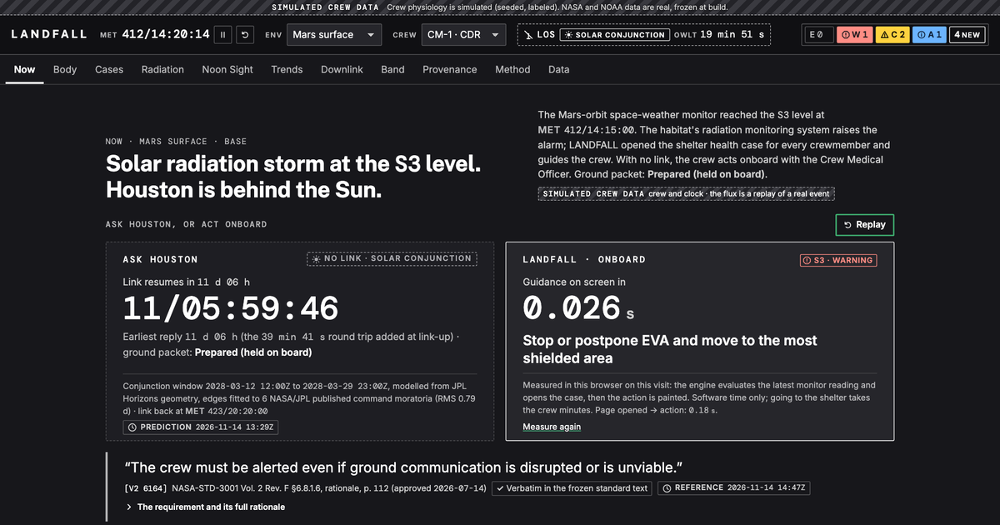

# LANDFALL

**Earth-independent health navigation for exploration crews.** NASA Space Apps Challenge 2026, *Create Health Monitoring Software for Astronauts on Space Missions*.



LANDFALL is offline-first health-monitoring software for crews who cannot wait for Houston. It checks each crewmember against NASA's limits and NOAA's storm-scale thresholds (Tier A: NASA-STD-3001 requirements frozen verbatim, an HRP evidence report's urine target and the NOAA S-scale) and against their own baseline (Tier B: a single-case test whose chance rate is measured and printed). A trigger reaching Caution or Warning opens one of three guided cases (radiation shelter, renal stone risk, sleep): one countermeasure, required steps, a reassessment tripwire, and escalation to the onboard Crew Medical Officer now (the Commander, the crew's second Crew Medical Officer, when the CMO is the patient) and to the flight surgeon through a consent-filtered FHIR packet that waits for the link. Escalations and overdue reassessments also raise annunciator alerts. NASA-STD-3001 leaves alert numbers to programs, so every number LANDFALL chose is labelled "design choice", and every case also prints as a paper cue card for when the screen is lost. The demo is a simulated Mars crew inside a solar conjunction modelled from JPL Horizons, during a replay of the real October 1989 proton event.

- **Live app:** https://landfall.landfall-web.workers.dev (static files, no backend; it reloads offline after one visit)
- **Demo video (30 s):** [VIDEO-TBC]
- **Printed cue cards:** [docs/landfall-cue-card.pdf](docs/landfall-cue-card.pdf)

## A two-minute audit path

Each link opens one view. `?env=` sets the environment (`iss`, `cislunar`, `lunar_surface` or `mars_surface`), and the footer's "Copy link to this view" makes a link to any view.

1. https://landfall.landfall-web.workers.dev/ : the scenario plays unprompted. Houston's earliest reply is 11 d 06 h away; LANDFALL's guidance is on screen in hundredths of a second.
2. https://landfall.landfall-web.workers.dev/#/case/spe_shelter?env=mars_surface : open "Why this fired" for the reading, the NOAA S3 threshold it reached, how far above it, and the requirement behind the rule.
3. https://landfall.landfall-web.workers.dev/#/method?s=gap : NASA-STD-3001's alert requirements leave the number to the program, verbatim.
4. https://landfall.landfall-web.workers.dev/#/provenance?chip=design+choice : the 54 of 107 rule entries that are ours.
5. https://landfall.landfall-web.workers.dev/#/radiation?env=mars_surface : the MSL RAD team's published storm rule (Löwe et al. 2025) replayed on the whole Curiosity RAD record that NASA's iSWA serves and checked row by row against the paper (7 of its 16 Table 1 surface rows reproduce; every difference is printed); STS-34 in orbit during the 1989 storm.
6. https://landfall.landfall-web.workers.dev/#/card/spe_shelter : the paper cue card ([V2 10130]); https://landfall.landfall-web.workers.dev/#/cards prints all three.
7. https://landfall.landfall-web.workers.dev/#/body?env=iss&crew=CM-2&region=muscles and https://landfall.landfall-web.workers.dev/#/body?env=mars_surface&crew=CM-2&region=muscles : one VO₂max reading (35.1 ml/min/kg) meets NASA's microgravity-EVA floor [V1 4001] and misses the surface-EVA floor [V1 4002], so at Mars it reads "EVA fitness floor not met"; EVA clearance itself is ground medical support's [V1 6006].
8. https://landfall.landfall-web.workers.dev/#/method?s=coverage : LANDFALL's scope scored against NASA's sample Integrated Medical Model output (Vol 1 Table E.2-1): 13.6 % watched by a case, 23.2 % asked daily, 6.3 % asked by a symptom only, 56.9 % not measurable here. Watched or asked does not mean detected.
9. https://landfall.landfall-web.workers.dev/#/band and https://landfall.landfall-web.workers.dev/#/data : the NOT MEASURABLE HERE boundary of the wearable concept; all 26 data snapshots and their caveats.

## Real or simulated

| What | Status | From |
|---|---|---|
| NASA-STD-3001 Vol 1 Rev C and Vol 2 Rev F: 20 + 37 requirements, 9 tables, Appendix E and F extracts | Real, frozen verbatim from PDFs identified by SHA-256 | NASA OCHMO |
| Earth–Mars and Earth–Moon light time | Real ephemeris (range ÷ c), labelled a prediction | JPL Horizons |
| Conjunction window, 2028-03-12 to 2028-03-29 | Modelled: Sun–Earth–Mars elongation below 2.04°, a threshold fitted to 6 published NASA/JPL command moratoria (RMS 0.79 d) | JPL Horizons; NASA/JPL |
| Proton flux in the scenario | Real record, time-shifted: GOES-7, October 1989, read as a Mars-orbit monitor with no distance or atmosphere correction (a labelled assumption) | NOAA NCEI |
| Mars-surface dose rate, and the storm-rule replay run on it | Real record: MSL RAD detector E, 390,270 samples, 2012-08-17 to 2026-11-12; the replay's numbers are derived from it | NASA CCMC iSWA; rule from Löwe et al. 2025 |
| Habitat dose rate during the event | Simulated: the measured Mars quiet rate, scaled so that NOAA's S3 flux gives 10 × (design choice) | LANDFALL |
| ISS dose (TEPC, one 2015 day), lunar-orbit dose (CRaTER), predicted ISS track | Real, labelled historical or predicted | NASA SRAG, CCMC, SPDF |
| Lab values and reference ranges | Real: SpaceX Inspiration4, n = 4, about 3 days in LEO, no in-flight samples in these files; reference ranges for the metabolic panel and blood count only | NASA OSDR (OSD-575, OSD-569, OSD-656) |
| Hazard, risk and research text; renal urine target; gap EIHSO-301 | Real, quoted verbatim | NASA HRP; Human Research Roadmap; HRP renal evidence report |
| STS-34 flight facts | Real, quoted verbatim | NASA mission page; Golightly et al. 1992 |
| Crew CM-1 to CM-4: vitals, sleep, PVT-B, urine, mood, VO₂max, scripted episodes and crew actions | Simulated from a fixed seed and labelled "SIMULATED CREW DATA" on every view; day-to-day noise from published within-person SDs where they exist, a design choice elsewhere | `ingest/sim_crew.py` |
| Mission calendar (MET 412/14:20:00 = 18 March 2028) | Fictional | LANDFALL |
| LANDFALL BAND wearable | Concept only: block diagram and BOM, never built | `hardware/` |

## Check our arithmetic

```bash
git clone https://github.com/amaroguilherme/landfall && cd landfall
uv sync --all-extras
uv run pytest -q                          # 1,365 passed, 11 skipped on a fresh clone
uv run python -m engine.vectors --check   # "vectors up to date": 801 fixed + 5,659 seeded random = 6,460
cd web && npm ci && npx vitest run        # 7,011 passed, 1 skipped (27 files)
npx tsc -p tsconfig.app.json --noEmit && npx vite build
```

Measured on 15 November 2026 on the code deployed as commit a796d65 (a clean export of that tree builds the live site byte for byte). Of the 11 Python skips, 3 are tests superseded by the scenario generator's own Tier B report, and 8 re-parse cached sources (the Vol 1 PDF, the arXiv preprint and the iSWA RAD record, the STS-34 sources) that live in the gitignored `.cache/`; with that cache present, pytest reports 1,373 passed (1,027 engine, 346 ingest) and 3 skipped. The TypeScript suite replays every shared vector in the browser engine (`web/src/engine/conformance.test.ts`), and the two engines agree to 1e-9.

## Architecture

LANDFALL works in two stages. At build time, one Python adapter per source fetches NASA, NOAA and CSA data and freezes it as JSON with its citation, caveats, retrieval time and SHA-256 (26 snapshots in `web/public/data/`, listed in `manifest.json`). At run time, the browser loads only those files and the rules, and a TypeScript engine evaluates them: pure functions that match the Python reference engine on the shared vectors. There is no server and no language model in the decision path; a service worker precaches the build, so every route reloads offline after one visit. The site is Cloudflare Workers static assets (no Worker code runs), deployed from the committed tree by `scripts/deploy.sh`.

| Path | What it is |
|---|---|
| `engine/` | Stdlib-only Python reference engine, with pytest. `engine/SPEC.md` is the contract between the rules, both engines and the scenario |
| `engine/rules/` | The rules as data: Tier A limits, Tier B indicators, the three cases, environments, the severity mapping, escalation tiers and refusals. The browser bundles the same files |
| `ingest/` | One adapter per source, plus the seeded crew simulator. `uv run python -m ingest --all` re-fetches every source and rebuilds `web/public/data/`; `--offline` replays the local cache |
| `web/` | Vite + React 19 + TypeScript app; `web/src/engine/` is the TypeScript engine |
| `hardware/` | LANDFALL BAND, a wearable concept at block level: `sensor-map.json`, `BOM.csv` |
| `scripts/` | QA over the Chrome DevTools Protocol (`qa-mobile.mjs`, `qa-offline.mjs`), the cue-card printer (`print-card.mjs`), the deploy script, and `video/` (the demo video and project-page figures, each on-screen claim checked against the app) |
| `docs/` | The printed cue cards (`landfall-cue-card.pdf`, `.png`) and the project-page text (`PROJECT_DESCRIPTION.md`) |

## Data sources

Every source, with its URL, retrieval date and SHA-256 where one applies, is in [CITATIONS.md](CITATIONS.md); its last section is generated from the shipped data and rules (`uv run python -m ingest.citations`). In the app, #/data shows each snapshot with its caveats word for word. Third-party software and fonts: [THIRD_PARTY.md](THIRD_PARTY.md).

## Use of AI

[AUTHORSHIP-TBC] We built LANDFALL with Claude Code (Anthropic) as the coding assistant. It wrote most of the code and drafts of the documentation under our direction, and ran checks of our claims against primary sources; we set the scope and the design, made the decisions and reviewed the results. No AI runs inside LANDFALL: every rule is data, evaluated by deterministic code.

## License and disclaimers

Apache-2.0: see [LICENSE](LICENSE). LANDFALL is a hackathon demonstration and **not a medical device**: no diagnosis, no medication or dosing advice. **Not endorsed by NASA**; no NASA insignia is used.
